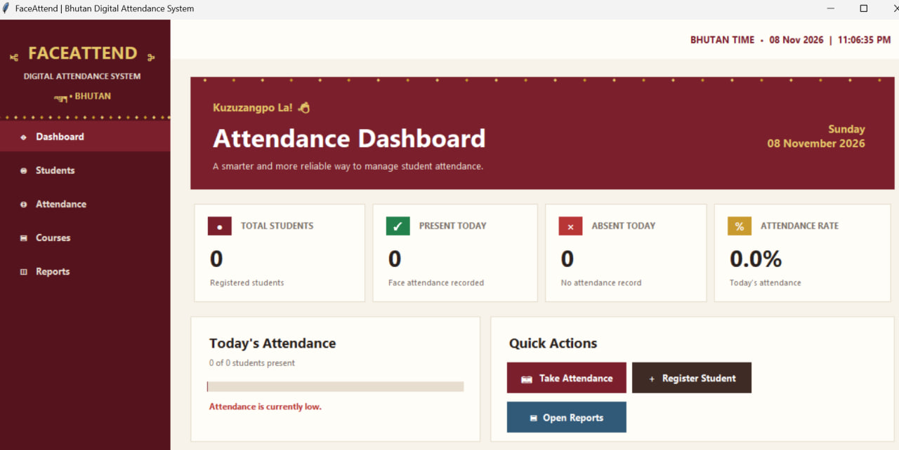
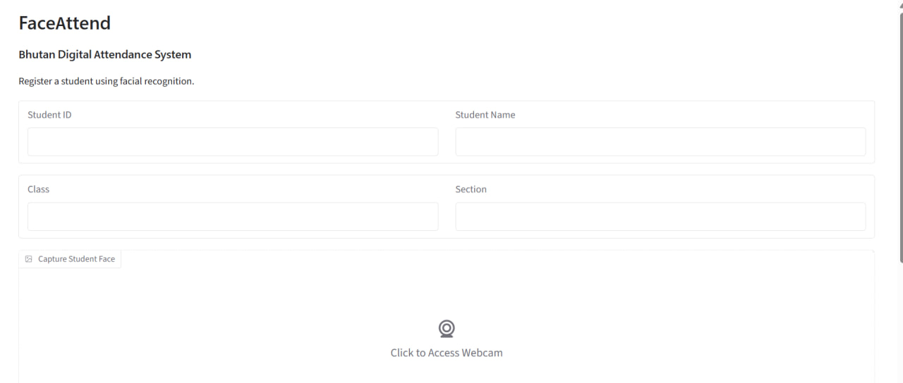
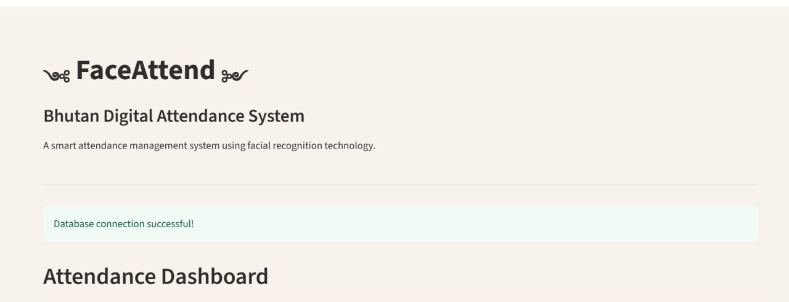

FaceAttend – Bhutan Digital Attendance System

1. Project Overview

FaceAttend is a facial-recognition-based attendance management system developed to make student attendance recording easier, faster, and more efficient.

The system uses facial recognition technology to identify registered students and record their attendance. It integrates a Python desktop interface with web-based interfaces and a Supabase database for storing student information, course details, and attendance records.

2. Project Objectives

To develop a digital attendance management system using facial recognition.

To reduce manual attendance-taking time.

To improve the accuracy of student identification and attendance recording.

To store and manage attendance records digitally.

To provide user-friendly interfaces for managing student attendance.

3. Key Features

Student Registration: Register students with their personal details and facial images.

Facial Recognition: Detect and recognise registered student faces.

Automatic Attendance: Record attendance when a registered student is recognised.

Course Management: Add and manage course information.

Attendance Reports: View and manage attendance records.

Dashboard: Display attendance-related information.

Database Integration: Store student, course, and attendance information using Supabase.

4. Technologies Used

Technology

Purpose

Python

Main programming language

Tkinter

Desktop graphical user interface

Gradio

Web-based interface

Streamlit

Web-based interface

OpenCV

Camera access and image processing

face_recognition

Facial detection and recognition

dlib

Facial recognition processing

NumPy

Numerical operations

Supabase

Cloud database

5. Project Structure

The FaceAttend project is organised into a desktop application and web-based applications. The web application directory contains separate Gradio and Streamlit interfaces, along with supporting modules and configuration files.

GUI PROJECT/
└── FaceAttend/
    │
    ├── faceattend_web/
    │   ├── .streamlit/
    │   │   └── config.toml
    │   │
    │   ├── .gitignore
    │   ├── database.py
    │   ├── face_engine.py
    │   ├── gradio_interface.py
    │   ├── requirements.txt
    │   ├── run.py
    │   ├── streamlit_app.py
    │   └── ui_helpers.py
    │
    ├── Screenshots/
    │
    ├── attendance_report.py
    ├── attendance.py
    ├── camera_test.py
    ├── dashboard.py
    ├── register_student.py
    ├── ui_helpers.py
    │
    ├── .gitignore
    ├── requirements.txt
    └── README.md

Description of Directories and Files

File/Folder

Purpose

faceattend_web/

Contains the Gradio and Streamlit web applications.

.streamlit/config.toml

Stores Streamlit configuration and theme settings.

database.py

Handles database operations for the web applications.

face_engine.py

Provides facial encoding and recognition functions.

gradio_interface.py

Implements the Gradio attendance interface.

run.py

Launches the Gradio application, if configured as its entry point.

streamlit_app.py

Implements the Streamlit attendance interface.

ui_helpers.py

Contains reusable web interface helper functions.

Screenshots/

Stores screenshots of the developed applications.

attendance_report.py

Generates attendance reports.

attendance.py

Handles attendance recording and management.

camera_test.py

Tests webcam functionality.

dashboard.py

Implements the main Tkinter desktop dashboard.

register_student.py

Handles student registration and facial image capture.

ui_helpers.py

Contains reusable desktop interface helper functions.

.gitignore

Specifies files and folders excluded from Git tracking.

requirements.txt

Lists the Python dependencies.

README.md

Provides project documentation and setup instructions.

6. Installation and Setup

Requirements

Python 3.13

Webcam

Internet connection

Supabase account

Step 1: Clone the Repository

Open PowerShell or Command Prompt and execute:

git clone https://github.com/rinchentshering002/FaceAttend.git

Step 2: Open the Project Folder

cd FaceAttend

Step 3: Install Desktop Application Dependencies

py -3.13 -m pip install -r requirements.txt

For Windows systems, facial recognition may require a compatible dlib installation.

Step 4: Configure Supabase

Create a .env file in the main FaceAttend folder.

Add the following configuration:

SUPABASE_URL=your_supabase_project_url
SUPABASE_KEY=your_supabase_secret_key

Replace the example values with your actual Supabase project credentials.

Security: Keep your .env file private. Never upload secret keys, passwords, or actual biometric data to GitHub.

Step 5: Run the Tkinter Desktop Application

From the main FaceAttend folder, execute:

py -3.13 dashboard.py

Step 6: Install Web Application Dependencies

Navigate to the web application directory:

cd faceattend_web

Install the required dependencies:

py -3.13 -m pip install -r requirements.txt

Step 7: Run the Gradio Application

From the faceattend_web directory, execute:

py -3.13 run.py

Open the local URL displayed in the terminal.

Step 8: Run the Streamlit Application

From the faceattend_web directory, execute:

py -3.13 -m streamlit run streamlit_app.py

Open the local URL displayed in the terminal.

7. Database Structure

The system uses Supabase to store and manage student information, course details, and attendance records.

Students Table

student_id

name

class

section

face_encoding

Courses Table

course_id

course_code

course_name

teacher

Attendance Table

student_id

course_id

attendance_date

status

check_in_time

## 8. Application Screenshots

### 8.1 Tkinter Desktop Dashboard

### 8.2 Gradio Web Application

### 8.3 Streamlit Web Application

9. Limitations

The system requires a working webcam.

Facial recognition accuracy may be affected by lighting and camera quality.

A stable internet connection is required for Supabase operations.

Database access requires correctly configured API credentials and security policies.

Facial recognition libraries may require additional installation and configuration.

10. Future Improvements

Improve facial recognition accuracy.

Add user authentication and role-based access.

Improve attendance report generation.

Add attendance export to Excel and PDF.

Improve the user interface and mobile accessibility.

Strengthen biometric data protection.

11. Team Members

Rinchen Tshering

Tandin Penjor

Pema Yangki

Tashi Lhamo

Sangay Choden

12. Acknowledgement

We would like to express our sincere gratitude to our lecturers, project supervisor, and everyone who supported us throughout the development of FaceAttend.

This project provided us with practical experience in Python programming, graphical user interface development, facial recognition, web-based applications, and database integration.

FaceAttend – Bhutan Digital Attendance System

Samtse College of Education
Royal University of Bhutan
